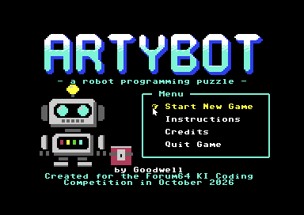
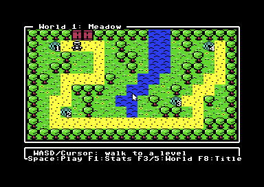
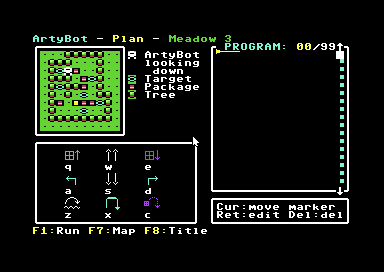
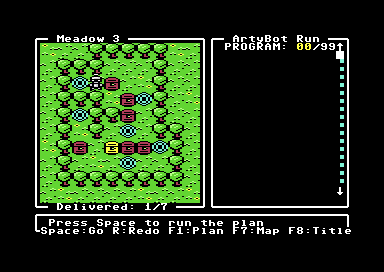
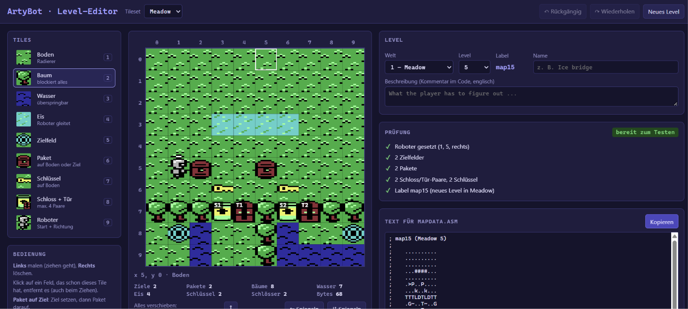

# ArtyBot — a robot programming puzzle for the C64

ArtyBot is a puzzle game for the PAL Commodore 64, written in 6502 assembly
for the **Forum64 AI Coding Competition** (October 2026, theme: *"Program your
robot!"*).



You don't steer ArtyBot directly. You look at the level, put together a list of
commands, press *Run* — and watch the little robot carry out your plan step by
step. If something goes wrong, the game tells you exactly what and why. Fix the
program, try again, and then try to solve it with fewer commands.

- Single-file PRG, runs on a stock PAL C64 and in VICE — no expansions, nothing
  is loaded after start
- 2 worlds with their own tile sets (**Meadow** and **Winter**), 10 levels
- World map in the style of *Donkey Kong Country Returns*: walk the robot from
  level to level, open the gate to the next world
- 9 commands: move, turn, pick up, drop, jump and throw
- Level elements: packages, targets, trees, water, slippery (and breakable)
  ice, keys, locks and doors
- Multicolour graphics, animated robot sprite, SID sound effects and jingles
- Keyboard and 1351 mouse support
- Level statistics: runs and commands per level

## Getting started

Load and run the PRG:

```
LOAD "ARTYBOT",8
RUN
```

or drag `build/artybot.prg` onto VICE (`x64sc -pal -autostart build/artybot.prg`).

The title screen offers *Start New Game*, *Instructions*, *Credits* and
*Quit Game* (W/S or cursor keys, Return/Space, or the mouse).

## How to play

Every level is a 10×10 field. Your goal: bring a package onto **every** target
field. A run fails if ArtyBot walks into something, falls into water or the
program ends before all targets are covered.

### World map



| Key | Action |
|---|---|
| WASD / cursor keys | Walk along the path |
| Space / Return / mouse click | Enter the level under the robot |
| F1 | Level statistics (F3/F5 switch worlds inside the overlay) |
| F3 / F5 | Previous / next world (once unlocked) |
| F8 | Back to the title screen |

Solved levels show a golden chest. When all levels of a world are solved, the
wooden gate at the top of the map opens and leads to the next world. The arch
in the corner of later worlds takes you back.

### Planning screen



The left side shows the level, a legend lists the tiles used in it, and the
right side holds your program (up to 99 commands). Hover the mouse over the
map to get a short explanation of each object.

The command palette uses a WASD layout:

| | | |
|---|---|---|
| **Q** Pick up | **W** Move forward | **E** Drop off |
| **A** Turn left | **S** Move back | **D** Turn right |
| **Z** Jump | **X** Turn 180° | **C** Throw |

| Key | Action |
|---|---|
| Q W E A S D Z X C | Insert command at the cursor |
| Cursor keys | Move the insert cursor |
| Shift + cursor | Select / move commands |
| Backspace | Delete (with confirmation) |
| Shift + CLR/HOME | Clear the whole program (with confirmation) |
| 1–9 | Switch to another level of the current world |
| F1 or R | Run the program |
| F7 | Back to the world map |
| F8 | Back to the title screen |

All palette icons and the bottom row are clickable with the mouse as well.

### Run screen



| Key | Action |
|---|---|
| Space | Start / pause / continue |
| R | Restart the run |
| F1 or P | Back to planning |
| F7 | Back to the world map |
| F8 | Back to the title screen |

The current command is highlighted in the program list, and the frame shows
how many packages have been delivered. When a run fails, a message explains
the reason ("ArtyBot is blocked", "Hands full", "Can't swim!", "The ice
broke!", …).

### Rules

- **Move forward / back** moves one field. Trees, packages, water and the edge
  of the field block — nothing is pushed.
- **Pick up / Drop off** act on the field in front of the robot. ArtyBot can
  carry one item at a time; a package can be picked up again from a target.
- **Jump** goes over the next field onto the one after it. Only a tree (or a
  closed door) in between stops the jump. The landing field must be free
  ground or a free target. Jumping while carrying is allowed.
- **Throw** lands the carried item two fields ahead, with the same rules as
  the jump.
- **Water** can't be entered, but it can be jumped or thrown across.
- **Ice** can be walked on, but ArtyBot slides until he reaches land or hits
  an obstacle. Sliding into open water sinks him. Jumping onto or off the ice,
  or throwing something onto it, breaks the ice.
- **Keys** are picked up like packages. Drop or throw a key into a **lock** to
  open the matching **door**. Closed doors block like trees.

Every run with a changed program counts as an attempt. Once a level is solved,
the statistics remember the number of runs and the shortest solution in
commands — a good reason to come back and improve it.

## Building

Requirements: [Martin Piper'S ACME](https://github.com/martinpiper/ACME/) 1.01 or
newer. Run it from the project directory (ACME resolves `!source` paths
relative to the working directory):

```
acme -f cbm --cpu 6510 -o build/artybot.prg src/main.asm
```

Alternatively use `make` (`make run` builds and starts VICE). The paths to
ACME and VICE are set at the top of the `Makefile` and can be overridden,
e.g. `make ACME=acme VICE=x64sc`.

The build also writes `Test.map`, `Test.lbl` and `Test.pdb` (map, labels and
debug info) into the project directory.

## Project layout

| Path | Contents |
|---|---|
| `src/main.asm` | Entry point, include order, size check |
| `src/startup.asm` | BASIC stub (`SYS 2061`), hardware and IRQ setup |
| `src/title.asm` | Title screen, menu, credits |
| `src/world.asm` | Themes, worlds, progress, world map, statistics |
| `src/editor.asm` | Planning screen: palette, program list, input |
| `src/run.asm` | Run screen: program execution, game rules, sprites |
| `src/mapdata.asm` | Level data and level drawing |
| `src/sound.asm` | Small SID note sequencer and sound effects |
| `src/input.asm` | Keyboard matrix and 1351 mouse |
| `src/video.asm`, `irq.asm`, `sprites.asm`, `util.asm` | Screen output, raster IRQ, sprites, helpers |
| `src/text.asm` | All UI texts |
| `src/gfx_*.asm`, `src/world_maps.asm` | Graphics and world maps (mostly **generated**, see below) |
| `inc/` | Constants, zero page / RAM layout, macros |
| `tools/` | Python generators, solver, emulator and tests |

### Tools

The graphics, world maps and part of the testing are done with small Python
scripts (run with `python -B` to avoid `__pycache__` folders):

- `gen_gfx_run.py`, `gen_theme_winter.py`, `gen_plan_tiles.py`,
  `gen_cmd_icons.py`, `gen_title.py` — generate tiles, sprites, icons and the
  title picture from ASCII art
- `gen_world_maps.py` — world maps from ASCII art, checks that every level
  node is reachable
- `gen_level_editor.py` — builds `level_editor.html`, a browser-based level
  editor that outputs records for `mapdata.asm`
- `solve_levels.py` — A* solver that finds the shortest solution of each level
  using the game's rules
- `c64sim.py` — a minimal C64 emulator (6502, IRQ, keyboard, VIC renderer)
  used by the `sim_*.py` scripts for automatic play-through tests and
  screenshots

### Level editor



The levels were designed with a small browser-based editor (user interface in
German). It uses the game's real tile sets and colours, so a level looks the
same as in the game. You paint trees, water, ice, targets, packages, keys,
lock/door pairs and the robot's start position onto the 10×10 field. A check
panel shows whether the level is complete, and the editor creates the
ready-to-paste record for `mapdata.asm` (including an ASCII preview as a
comment). Existing levels can be loaded and changed.

Create it with `python -B tools/gen_level_editor.py` and open
`tools/level_editor.html` in a browser. Rebuild it after changing tile sets,
theme colours or levels.

## Memory map

- PRG from `$0801`, code and data end below `$C000` (checked at assembly time)
- VIC bank 3: screen `$C000`, character set `$C800`, title character set
  `$D000`, sprites from `$E000`
- Level work buffer `$0200`, target list `$0280`, robot program `$0300`

## AI disclosure

This entry was made for a competition about AI-assisted programming.

- **AI used:** Claude (Anthropic), via Claude Code / Claude chat.
- **What the AI did:** practically all of the assembly code, the game
  mechanics, graphics and sound (pixel art via the generator scripts), the
  Python tools (generators, solver, emulator, tests) and this documentation.
- **What I did (Goodwell):** game idea and concept, game design and rules,
  level design, direction and feedback on every feature, playtesting in VICE.

## License

Public domain — see [LICENSE](LICENSE) (The Unlicense).

---

*Dedicated to Julia, Ben & Silvia.*
